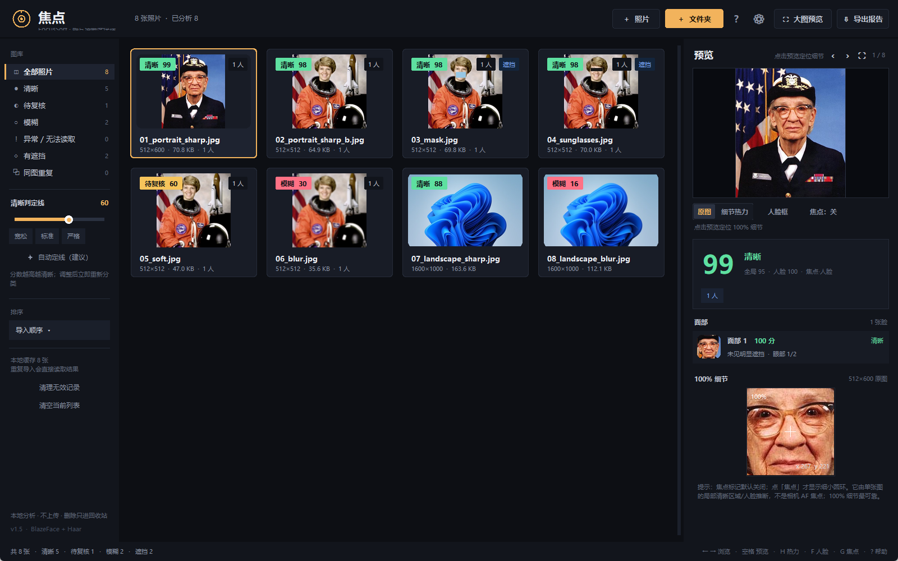
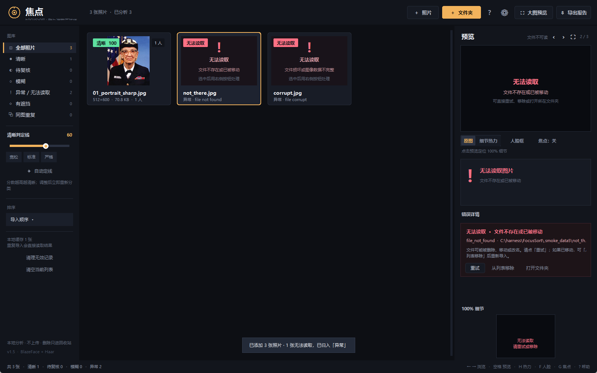
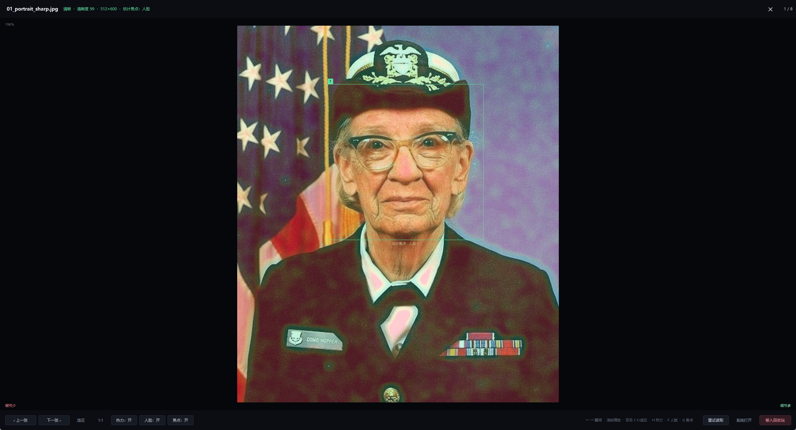

# 焦点 FocusSort

一个本地运行的照片清晰度快筛工具：批量导入照片，先按「是否失焦/发虚」排序，再对可疑照片做 100% 细节复核；同时给出人脸清晰度、面部遮挡和「相机大概对焦在哪里」的估计。

> **所有图片分析都在本机完成，不上传照片。**  
> 程序不会删除或移动原照片；批量删除只通过 Windows 回收站 API，可在回收站恢复。



## v1.5 修复的三个回归

1. **焦点标记不再遮挡画面**
   - 焦点默认关闭，预览工具栏有独立的「焦点：关/开」按钮。
   - 打开后只是**细虚线小圆环 + 一行小字**（如「估计焦点 · 人脸 1」/「估计焦点 · 细节」），没有大十字、没有大面积金字。
   - 「原图 / 细节热力」与焦点、人脸框可以任意组合，三个覆盖层都能关。
2. **上次会话有清退机制**
   - 启动时逐条检查上次照片是否仍存在、可读、格式受支持；失效记录自动移除，并提示「已清理 N 个失效文件」。
   - 设置中可关闭「启用上次会话恢复」；最多恢复 300 张，超过上限会提示。
   - 提供「清空当前列表」「清理无效记录」；清空只清列表，不删除文件。
   - 缓存可清理：源文件已不存在的缩略图/元数据、按天数未使用、或清空全部缓存。
3. **坏图不再拖垮整批**
   - 单张读取失败只影响该卡片；其他照片继续分析。
   - 错误卡片显示可操作原因，并提供「重试」「从列表移除」「打开所在文件夹」。
   - 左侧新增「异常 / 无法读取」筛选和计数。
   - HEIC/HEIF 优先使用 `pillow-heif`；未安装解码器时明确提示安装或转 JPG。
   - 修复大图单/双人像触发重叠裁切时，内部人脸框合并导致的 `IndexError`；这类照片现在会正常出分。
   - 增强大图人脸候选过滤，减少手臂、衣带等被误当成人脸；焦点优先落在有 BlazeFace 关键点的真实人脸。
   - 导入前做轻量探测；失败结果不写成功缓存；缓存 key 包含分析版本、修改时间、文件大小和选项。



## 快速开始

1. 双击 **`启动 FocusSort.bat`**（或 `Start FocusSort.bat`）。
2. 首次使用：把照片或整个文件夹拖进窗口，或点右上角「照片 / 文件夹」。
3. 等缩略图出现分数。左侧按「清晰 / 待复核 / 模糊 / 异常 / 有遮挡 / 同图重复」筛选。
4. 双击缩略图或按空格，进入最大化大图预览；`←/→` 连续翻阅，`Esc` 返回。

如果上次有有效照片，启动后会恢复并直接进入大图预览；如果没有任何有效照片，则显示正常空图库/导入引导。

## 分数与状态

分数 0–100，表示画面里还保留了多少可分辨的细节。有人脸时优先参考人脸；没有可靠人脸时，参考局部 Laplacian 细节、高频能量和频谱斜率。

- **清晰**：达到判定线（默认 60）。
- **待复核**：接近判定线，建议看 100% 细节。
- **模糊**：明显低于判定线。
- **细节少**：天空、纯色墙、薄雾等低纹理画面，分数参考性低，不武断判模糊。
- **无法读取**：文件不存在、权限不足、格式不支持、HEIC 解码器缺失、文件损坏、内存不足等；卡片会给出具体原因。

判定线可在左侧拖动，调整后立即重新分类，不需要重新分析。**「自动定线（建议）」只给建议**，点击建议文字才会应用，不会偷偷改用户设置。

## 大图连续预览

- 双击缩略图、按空格或回车打开；不会调用系统看图应用。
- 预览页按打开时的「当前筛选结果」翻阅：先点「清晰」就只在清晰照片里翻。
- 显示 `1/N`、文件名、分数、状态。
- 滚轮缩放、拖拽平移、真正 1:1 原图像素（受 7000px 内存上限限制）、适应窗口。
- `H` 细节热力、`F` 人脸框、`G` 焦点；**每次启动都默认关闭**，照片本身不被覆盖。
- `Delete` 移入回收站（需确认）；关闭/`Esc` 后回到图库并保持当前选中。
- 只允许一个预览窗口，重复双击不会叠出多个。
- 右键缩略图仍保留「用系统应用打开」。

## 人脸与遮挡

人脸检测使用 BlazeFace（TFLite，经 OpenCV DNN 运行）和 Haar 级联两套方法；大图会在四个重叠裁切上再跑一次 BlazeFace，提升合照、小脸、侧脸检出率。检测到关键点时先摆正脸部，再计算人脸清晰度和遮挡提示。

- 可提示：口罩、墨镜/深色眼镜、衣领等造成的明显下半脸或眼部遮挡。
- 每张脸显示分数、眼部特征数量、遮挡置信度和原因（如「下半脸肤色区域明显减少」）。
- 可能漏判：手掌、头发、透明眼镜、严重虚化、过小人脸。
- **不做身份识别，不保存人脸特征，不输出「这是谁」。**

## 焦点估计

- 有可靠大脸时优先最清晰人脸中心；否则取局部清晰度图里最锐的集中区域。
- 结果包含 `x/y`、来源（人脸/画面细节）、置信度、标签。
- 这是**从单张图景深推断的估计，不是相机 AF 元数据**，也不是对焦点框。
- UI 默认关闭；打开后小圆环 + 小字，不影响看脸和细节。



## 同一照片的不同格式

用感知哈希 + 尺寸归一化边缘指纹 + 画面比例判断：

- 同一张照片的 JPG/PNG/WEBP、不同分辨率版本会显示「同图×N」，左侧有「同图重复」筛选。
- 右侧紫色提示可进入管理：按「清晰度最高 / 分辨率最高 / 文件最大」每组保留一张，其余移入回收站。
- 模糊版、不同裁切、明显修图通常不会合并；**宁可少分组，不乱删**。
- 去重删除前必须明确确认；删除只进回收站。

## 导入、选择与删除

- 支持 JPG / JPEG / PNG / WEBP / BMP / TIF / TIFF；安装 `pillow-heif` 后支持 HEIC / HEIF。
- `Ctrl+单击` / `Shift+单击` 多选，`Ctrl+A` 全选当前筛选。
- 多选后底部出现批量条：已选 N 张、全选、移入回收站、取消选择。
- `Delete` 批量移入 Windows 回收站，必须二次确认；文件可恢复。
- 程序不会直接永久删除；回收站 API 失败会终止并提示。
- 「从列表移除（不删文件）」是独立操作，右键菜单和异常卡片均可使用。
- 所有删除/清空/去重都有明确确认和「可恢复」说明。

## 快捷键

| 操作 | 快捷键 |
| --- | --- |
| 添加照片 | `Ctrl+O` |
| 添加文件夹 | `Ctrl+Shift+O` |
| 连续翻阅当前筛选 | `← → ↑ ↓` |
| 多选照片 | `Ctrl+单击` / `Shift+单击` |
| 全选当前筛选 | `Ctrl+A` |
| 打开大图预览 | `空格` / `回车` |
| 全部 / 清晰 / 待复核 / 模糊 / 异常 / 有遮挡 / 同图重复 | `1` – `7` |
| 细节热力图 | `H` |
| 人脸框 | `F` |
| 估计焦点细环 | `G` |
| 微调判定线 | `+` / `-` |
| 重新分析当前照片 | `F5` |
| 批量移入回收站 | `Delete` |
| 导出当前筛选 CSV | `Ctrl+E` |
| 关闭预览/弹窗，或清除主窗口选择 | `Esc` |

大图预览还支持：滚轮缩放、拖拽平移、双击在 1:1/适应窗口间切换、`Home/End` 跳转首尾。键盘快捷键只在对应窗口生效，不会在预览窗和主窗同时触发两次。

## 支持格式与 HEIC

- 常驻支持：JPG / JPEG / PNG / WEBP / BMP / TIF / TIFF。
- 可选 HEIC/HEIF：安装 `pillow-heif` 后直接导入：
  ```bat
  python -m pip install -r requirements-heic.txt
  ```
- 没有解码器时不会进入分析队列，而是直接标为异常，提示「HEIC/HEIF 解码器未安装」，并建议用系统「照片」导出 JPG。
- 读取时处理 EXIF 方向、CMYK/调色板等模式转换、空文件、截断/损坏文件，以及超大图安全上限。

## 运行环境

- Windows 10/11，Python 3.10+（推荐 3.12/3.14）。
- 启动器会优先找本机 `pythonw.exe`；`vendor/` 已包含 `opencv-python-headless` 和 `tkinterdnd2`。
- 还需要 `numpy`、`Pillow`。如果环境里没有，在 FocusSort 文件夹运行：
  ```bat
  python -m pip install -r requirements.txt
  ```
- 依赖安装成功一次后，日常使用完全离线。

如果双击启动器没反应，请检查 `%LOCALAPPDATA%\FocusSort\error.log`，或按 README 末尾的命令手动运行 `python run.py` 查看报错。

## 上次会话、清空列表与缓存

- 右上角 **⚙ 设置与维护**：
  - 「启用上次会话恢复」默认开；可关。
  - 「清理无效记录」：只移除当前列表里已失效的记录。
  - 「清空当前列表」：不删除文件，也不会在下次启动恢复这批照片。
  - 缓存维护：清源文件已不存在的缓存、清理 N 天未使用缓存、清空全部缓存。
- 会话最多恢复 **300 张**。启动时会清理失效条目；清理数量用轻量 toast 提示。
- 清空列表、去重、批量删除都有二次确认和「可恢复 / 不影响原图」说明。

缓存位置：

```text
%LOCALAPPDATA%\FocusSort\
├─ cache\meta\       分析结果 JSON
├─ cache\thumbs\     缩略图 JPG
├─ settings.json     阈值、排序、上次会话、面板偏好
└─ error.log         未处理错误堆栈
```

清理缓存**不会影响原照片**。删掉整个 `%LOCALAPPDATA%\FocusSort` 也能清空会话和缓存。

## 开发与测试

```bat
python -m py_compile app.py analyzer.py theme.py run.py
python -m unittest discover -s tests -v
python run.py demo
```

`analyzer.py` 可单独用于脚本分析：

```python
from analyzer import Analyzer, status_for
a = Analyzer()
r = a.analyze("photo.jpg", {"faces": True, "occlusion": True})
print(r["score"], r["focus"], status_for(r, 60), r["faces"])
```

当前测试覆盖：清晰 vs 模糊、人脸/口罩/墨镜、正常眼镜不误报、大图单人像重叠裁切、合照多脸、焦点来源、EXIF 方向、同图格式分组（模糊/裁切不合并）、坏文件原因与不缓存、缓存 key/清理、会话校验与上限、批量删除后的列表同步。

## 目录结构

```text
FocusSort/
  启动 FocusSort.bat   一键启动（推荐）
  Start FocusSort.bat  英文备用名
  run.py                入口（依赖检查 + error.log）
  app.py                界面与交互
  analyzer.py           清晰度/人脸/遮挡/焦点/缓存
  theme.py              深色主题与自绘控件
  models/               BlazeFace 模型
  vendor/               OpenCV + TkinterDnD
  demo/                 8 张示例照片
  demo_dup/             同图不同格式示例
  tests/                自动化回归测试
  docs/                 截图
```

## 已知限制

- 清晰度是内容相关的启发式分数，不是实验室级 MTF；强锐化、强降噪、极简画面都会影响分数。
- 「估计焦点」是单张图景深推断，不是相机 AF 元数据；整张虚焦或主体/背景都锐时可能不准。
- 遮挡检测是启发式估计，不构成身份识别；不做人脸特征保存。
- 同图分组宁严勿滥：明显改色、裁切、加字可能不会合并，请人工复核。
- 1:1 原图像素加载有 7000px 长边内存上限，超大图会先缩到这个上限；请以原始文件核对极端像素级细节。
- 批量很大时首次分析会花时间；之后有缓存会快很多。
- 目前只处理照片，不处理 RAW 和视频。
- HEIC 需要用户额外安装 `pillow-heif`；不装也能正常使用其他格式。

第三方组件与模型许可见 [THIRD_PARTY_NOTICES.md](THIRD_PARTY_NOTICES.md)。
